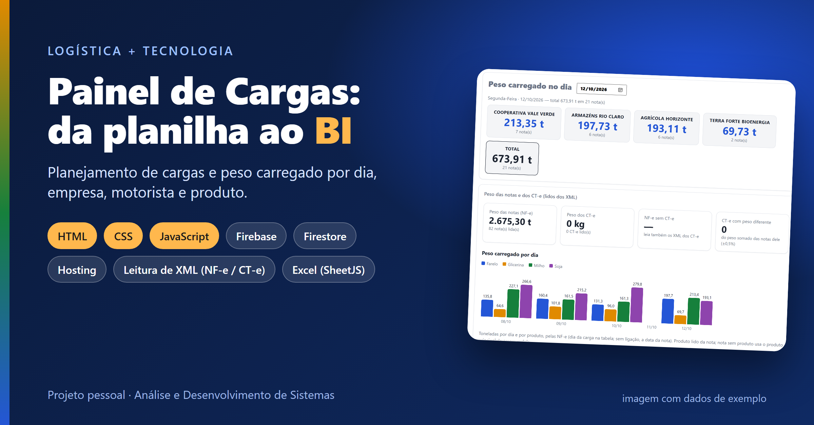
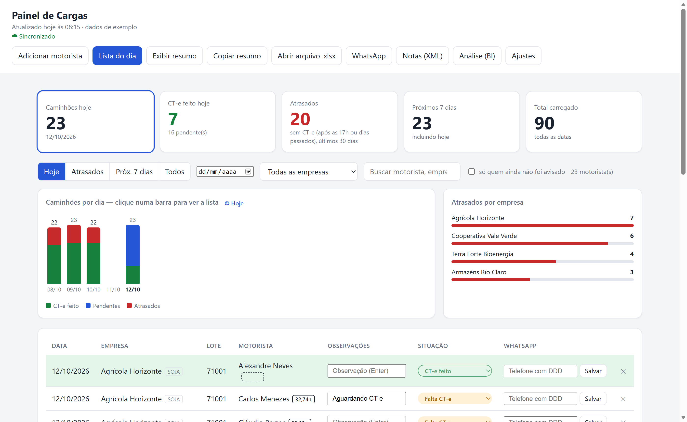
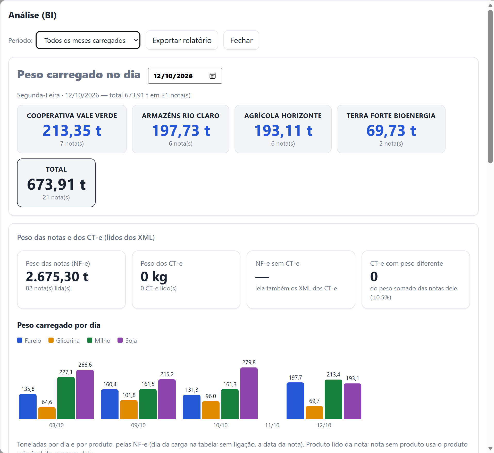
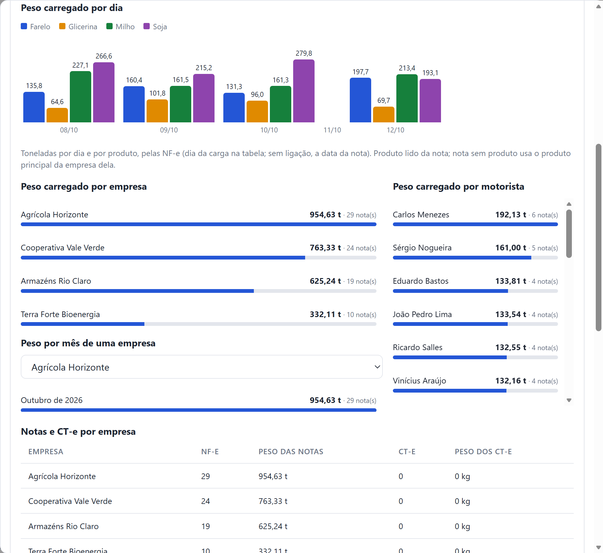

# Cargo-Dashboard
Cargo Dashboard
[README.md](https://github.com/user-attachments/files/33352934/README.md)
# 🚛 Painel de Cargas — da planilha ao BI



Painel web para **planejamento de carga e descarga de caminhões**, criado a partir de um problema real de logística: o planejamento do dia vivia numa planilha do Excel Online, editada por várias pessoas, sem uma visão rápida do que estava atrasado, de quanto foi carregado e de onde estavam os gargalos.

O painel lê a planilha, lê os **XML das NF-e e dos CT-e** e transforma tudo em indicadores, listas do dia e uma **Análise (BI)** de peso carregado por dia, empresa, motorista e produto.

> ⚠️ **Todos os dados e imagens deste repositório são fictícios** (empresas, motoristas, placas e pesos inventados). Nenhum dado da operação real está no código.

## ▶️ Teste agora (demonstração)

A versão de demonstração roda direto no navegador, com dados fictícios e sem nenhuma configuração. As alterações não são salvas.

- Abra o arquivo [`docs/index.html`](docs/index.html) no navegador, ou
- [link da demonstração no GitHub Pages — preencher depois de ativar o Pages]

## 📸 Telas

| Painel do dia | Análise (BI): peso no dia |
|---|---|
|  |  |



## ✨ Funções

**Planejamento do dia**
- Indicadores: caminhões de hoje, CT-e feito hoje, atrasados, próximos 7 dias e total carregado.
- Gráfico de caminhões por dia (com rolagem horizontal); clicar numa barra mostra a lista daquele dia.
- Filtros: hoje, atrasados, próximos 7 dias, todos, data, empresa, busca por motorista/empresa/lote e "só quem ainda não foi avisado".
- Listas em ordem alfabética de motorista; cada dia colado fica guardado no histórico.
- Situação por carga (*Falta CT-e*, *Carregado sem CT-e*, *CT-e feito*), com linhas coloridas e **alerta vermelho às 17h** para o que ficou sem CT-e.
- Edição direto na tabela: dois cliques no nome ou na empresa, campo de observação com Enter, exclusão e restauração de linhas.
- Cadastro manual de motoristas, sem depender da planilha.

**Entrada de dados**
- Colar a aba do Excel Online (Ctrl+V) ou abrir um arquivo `.xlsx` (inclusive as cores das células, como "CT-e feito").
- Arrastar para a tela os **XML de NF-e e CT-e** (arquivos soltos ou pastas inteiras).

**Comunicação**
- Aviso aos motoristas por **link do WhatsApp** com mensagem pronta (sem automação, o envio é sempre manual) e agenda de telefones.
- Resumo do dia no estilo da planilha (*dia · lote · cotas*), copiável com as linhas da tabela para WhatsApp e Teams.

**Peso e Análise (BI)**
- Peso lido das NF-e (soma dos volumes) e dos CT-e, com conferência de **CT-e com peso diferente do somado das notas** e de **NF-e sem CT-e**.
- Ligação automática de cada nota ao motorista da tabela (mesmo nome, empresa e dia próximo).
- Peso carregado **por dia, por produto, por empresa e por motorista**; peso do dia por empresa; peso mês a mês de uma empresa escolhida.
- Peso digitado à mão na tabela, que vale no lugar das notas daquela linha e entra em todos os totais.
- Nomes de empresas diferentes nas notas e na planilha são unidos (ex.: *"ARMAZENS RIO CLARO SERVICOS E ARMAZENAMENTO S/A"* e *"Armazéns Rio Claro"*).
- Relatório exportável.

**Trabalho em equipe**
- Opcional: sincronização em tempo real entre várias pessoas pelo **Firebase** (Firestore + login compartilhado), com funcionamento offline.
- Sem a nuvem, tudo funciona normalmente só no navegador (dados guardados no próprio computador).

## 🛠️ Tecnologias

- **HTML, CSS e JavaScript** puros, em **um único arquivo** gerado por um script de montagem (sem framework)
- **Firebase**: Firestore (banco), Authentication (login compartilhado) e Hosting
- **[SheetJS](https://sheetjs.com/)** (`xlsx.js`) para ler planilhas Excel
- **DOMParser** para ler os XML de NF-e e CT-e
- **IndexedDB / localStorage** para guardar os dados no navegador
- **Node.js** só para montar o arquivo final

> Projeto desenvolvido com apoio de IA (Claude). A definição do problema, as regras de negócio e a validação dos números vieram da experiência prática em logística.

## 💻 Como rodar

Precisa do [Node.js](https://nodejs.org/) apenas para montar o arquivo final.

```bash
# painel normal (funciona só no navegador, sem nuvem)
node fonte/build.js dist/index.html
# depois abra dist/index.html no navegador

# versão de demonstração, com dados fictícios
node fonte/build.js docs/index.html --demo
```

### Com sincronização pelo Firebase (opcional)

1. Crie um projeto no [Firebase](https://console.firebase.google.com/) e ative **Firestore**, **Authentication → E-mail/senha** e **Hosting**.
2. Crie um usuário (e-mail + senha) para a equipe compartilhar.
3. Copie `fonte/firebase-config.example.json` para `fonte/firebase-config.json` e preencha com os dados do seu projeto e o e-mail do usuário compartilhado.
4. Copie `.firebaserc.example` para `.firebaserc` e coloque o ID do seu projeto.
5. Em `firestore.rules`, troque o e-mail de exemplo pelo e-mail do usuário compartilhado.
6. Instale o Firebase CLI (`npm install -g firebase-tools`), faça `firebase login` e rode `publicar.bat` (ou `npm run build:firebase` seguido de `firebase deploy`).

## 🗂️ Estrutura

```
fonte/painel.src.html   código do painel (HTML + CSS + JavaScript)
fonte/build.js          monta o arquivo único (código + SheetJS + configuração do Firebase)
fonte/xlsx.js           biblioteca SheetJS
demo/seed.js            dados fictícios da demonstração
docs/index.html         demonstração pronta (GitHub Pages)
docs/img/               imagens deste README
firebase.json           configuração do Firebase Hosting
firestore.rules         regras de segurança (só o usuário compartilhado acessa)
publicar.bat            monta e publica no Firebase (Windows)
```

## 🔒 Privacidade e segurança

- Os dados da operação ficam no navegador de quem usa e, se a nuvem estiver ligada, no Firestore do **seu** projeto, protegido por login. Nada disso está no repositório.
- `fonte/firebase-config.json`, `.firebaserc` e os arquivos de dados reais (`.xlsx`, `.xml`, `.pdf`) estão no `.gitignore`.
- O painel **não guarda CPF** de motoristas (o CPF que vem nos XML é ignorado na leitura).

## 📄 Licença e créditos

- Biblioteca de leitura de planilhas: [SheetJS Community Edition](https://github.com/SheetJS/sheetjs) (Apache-2.0).
-

Feito por Mauricio Zarpelon — estudante de Análise e Desenvolvimento de Sistemas com experiência em logística.
[LinkedIn] www.linkedin.com/in/mauricio-zarpelon-7669b22b8
